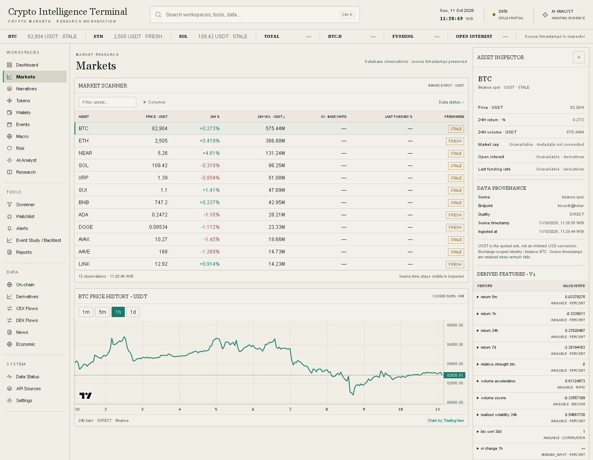
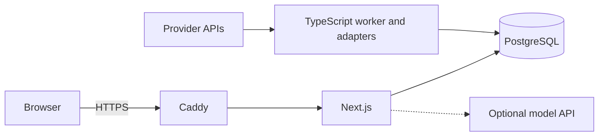
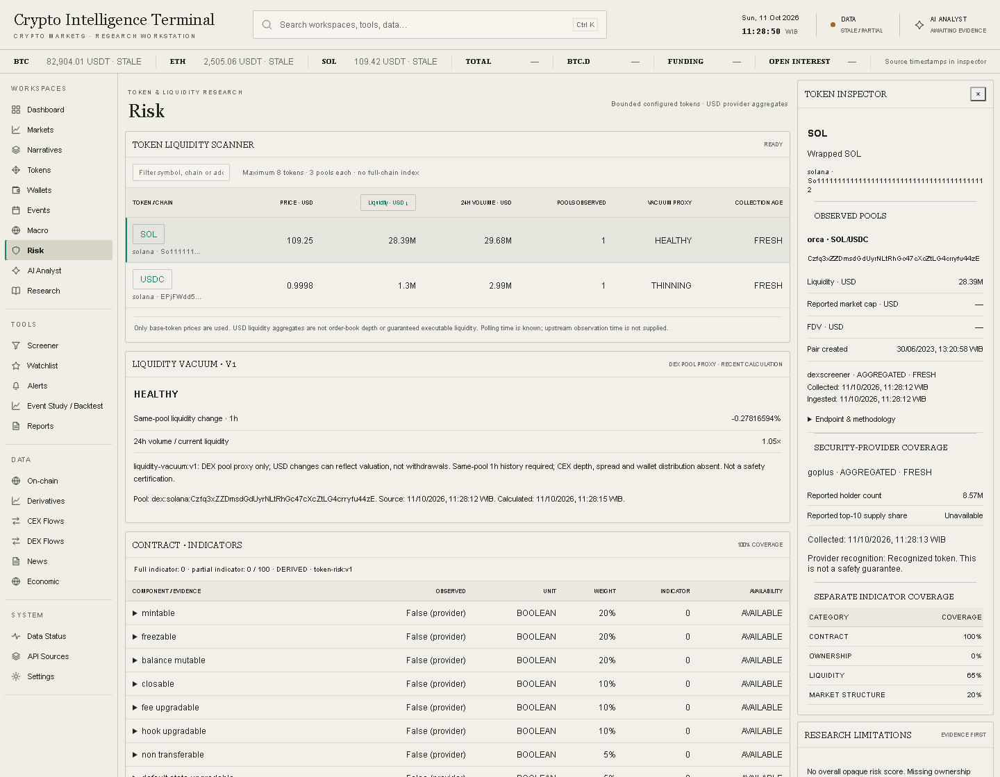
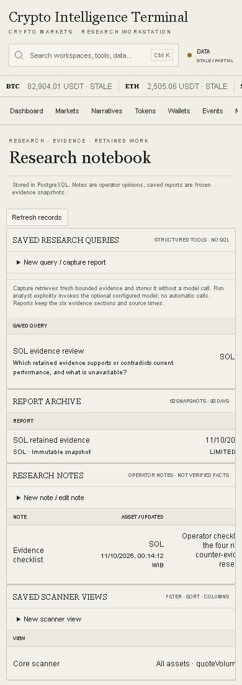

# Crypto Intelligence Terminal

An evidence-first crypto research terminal for exploring market structure,
on-chain activity, risk, narratives, and macro events in one workspace.



## What it does

- **Monitor markets:** live spot prices, stored candles, funding and open interest, with source timestamps and freshness indicators.
- **Compare signals and narratives:** relative strength, volume, volatility, breadth and explainable component scores.
- **Inspect token risk:** separate contract, ownership, liquidity and market-structure evidence, including a historical DEX-pool liquidity proxy.
- **Research Solana wallets:** tracked-address activity, transfers, labels and transaction-supported relationships.
- **Study macro events:** sourced releases, observed FRED revisions, event windows and descriptive cross-market statistics.
- **Build analyst briefs:** read-only evidence tools organize facts, signals, counter-evidence and sources; model interpretation is optional.
- **Keep research together:** watchlists, saved views and queries, notes, explainable alerts and immutable report snapshots.

The interface favors dense tables, an asset inspector and keyboard navigation.
Open the command palette with Ctrl/Cmd K or `/`.

## Architecture



The worker collects and validates provider data, computes research signals and
evaluates alerts. The web application reads PostgreSQL and manages research
records; market pages do not call external providers. Docker Compose runs these
four services, with Caddy handling production access and HTTPS.

| Area              | Stack                                                                      |
| ----------------- | -------------------------------------------------------------------------- |
| Application       | Next.js 16, React 19, TypeScript, TanStack Query/Table, Lightweight Charts |
| Data              | PostgreSQL 16, Drizzle, Zod                                                |
| Runtime and tests | Node.js 24, pnpm, Docker Compose, Caddy, Vitest, Playwright                |

## Getting started

Install Node.js 24 and pnpm 10.33.0, then:

```sh
git clone https://github.com/Jertig/crypto-intelligence-terminal.git
cd crypto-intelligence-terminal
pnpm install --frozen-lockfile
pnpm dev
```

Open [localhost:3000](http://127.0.0.1:3000). This starts the interface without
requiring credentials. Follow [local development](docs/development.md) to connect
PostgreSQL and run the ingestion worker, or start the complete local Docker stack.
Configuration is documented in [data sources](docs/data-sources.md); secrets belong
in the ignored environment file.

## Screenshots

Token risk with separate indicators and their supporting evidence:



<details>
<summary>Research notebook on mobile</summary>



</details>

These are real application captures. Source gaps and stale observations remain visible.

## Testing

Unit, PostgreSQL integration, browser/E2E and production-container checks run in
[CI](https://github.com/Jertig/crypto-intelligence-terminal/actions).
Locally, `pnpm qa` runs documentation checks, formatting, lint, strict types, unit
tests and the production build. See the [test commands and database setup](docs/development.md#testing)
for integration and browser tests.

## Data sources

| Access               | Integrations                                                                        |
| -------------------- | ----------------------------------------------------------------------------------- |
| Public endpoints     | Binance spot and derivatives, DEX Screener, GoPlus                                  |
| Optional credentials | Helius for Solana wallets, FRED for macro series, OpenAI for analyst interpretation |
| Not connected        | CoinGecko, DefiLlama, dedicated news and CEX/DEX-flow feeds                         |

Availability depends on each provider and deployment region. Binance spot, DEX
Screener and GoPlus have been exercised live; futures requests timed out in local
verification. Credential-based integrations have deterministic coverage but have
not been verified live. See [provider configuration and limits](docs/data-sources.md).

## Documentation

- [Architecture](docs/architecture.md) and [development](docs/development.md)
- [Data provenance](docs/data-provenance.md) and [research methodologies](docs/methodologies.md)
- [Deployment](docs/deployment.md), [operations](docs/operations.md) and [recovery](docs/disaster-recovery.md)
- [Security](docs/security.md) and [reliability](docs/reliability.md)

## Status and limitations

This is a single-operator research application. Public deployment and off-host
recovery have not yet been verified. Some studies need additional credentials,
sourced events or retained history. Wallet relationships are evidence, not proof
of ownership; statistical associations do not establish causation. Risk and
reputation methods are uncalibrated. Alerts are in-app, and AI interpretation is
optional and read-only. There is no trading execution or wallet signing.
