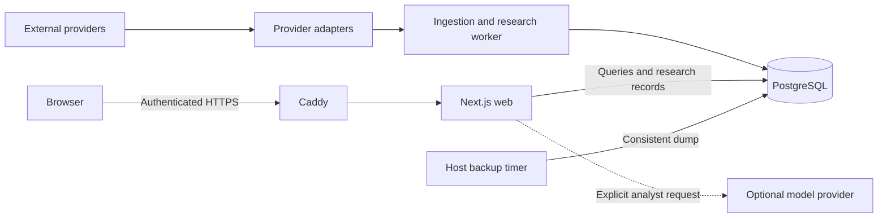

# Architecture

The terminal uses four runtime services: a Next.js web application, one TypeScript
worker, PostgreSQL 16 and Caddy. Host migration and backup commands run as one-off
operations. There is no separate queue, cache or analytics database.

## Service boundaries

The worker owns scheduled provider calls, normalization, feature/risk computation,
alerts, retention and operational measurements. Market-facing HTTP routes read
stored projections, so opening a workspace does not multiply provider requests.
The optional analyst adapter is the exception: an explicit submission can call its
configured model API, while all evidence tools remain read-only database queries.

Caddy handles production HTTPS and gateway authentication. PostgreSQL has no
published production port. Separate web and worker database roles have only the
grants needed by their jobs; administrator migrations are run explicitly.

## Repository layout

| Path                 | Responsibility                                                              |
| -------------------- | --------------------------------------------------------------------------- |
| `apps/web`           | Routes, terminal workspaces, shared query state and research forms          |
| `apps/worker`        | Provider schedules, derived evidence, alerts and process lifecycle          |
| `packages/domain`    | Validation contracts, pure calculations, versions and evidence rules        |
| `packages/providers` | Fixed-origin adapters, normalization and provider failures                  |
| `packages/db`        | Drizzle schema, migrations, persistence and query projections               |
| `infra`              | Container builds, gateway, runtime grants, backups and restore verification |
| `tests`              | Deterministic unit fixtures, PostgreSQL integration and browser behavior    |

pnpm workspaces share these packages without publishing them. Strict TypeScript
and Zod validate boundaries; Drizzle owns the migration history. Generated schema
snapshots and lockfiles are committed because they make builds and migrations
reproducible.

## Data flow

1. A provider adapter validates a response and normalizes identity, units and times.
2. A worker persists it transactionally, with duplicate and late-arrival guards.
3. Domain functions derive versioned features from eligible retained observations.
4. Query projections expose values, lineage, coverage and missing-input reasons.
5. The terminal and analyst tools consume those projections.

Market snapshots are latest-value records; closed candles and derived observations
have retention policies. Token data keeps contract, ownership, liquidity and market
structure separate. Wallet activity is sampled per configured address. Macro
period dates, observed revisions and collection times remain distinct. Events are
immutable records with source citations.

Research records share the same database. Saved views reuse the scanner; saved
queries select typed analyst tools. Report capture retrieves evidence without a
model call, freezes its as-of state and stores an immutable body with a digest.
A serial alert evaluator records explainable state transitions. See
[research workflow](research-workflow.md).

## Design decisions

- **One worker:** the configured universes and polling schedules share a single,
  resource-limited process. A queue would add operations without an established need.
- **PostgreSQL for observations and research:** transactions, constraints and
  indexed queries support idempotent ingestion and consistent records in one store.
- **Shared pure calculations:** formulas can be tested independently from providers,
  storage and UI. Method versions and input references make results auditable.
- **Provider isolation:** credentials and network details stay behind adapters.
  Missing credentials or one provider failure do not block unrelated ingestion.
- **Stored evidence before interpretation:** the analyst cannot replace source
  values or invent citations. Its retrieval and output contracts are documented in
  [AI analyst](ai-analyst.md).

The web shell can render without a database. Liveness differs from database/worker
readiness. Capacity protection pauses ingestion and research writes while retained
reads, heartbeat and cleanup continue. See [reliability](reliability.md),
[operations](operations.md) and the [reference deployment profile](reference-profile.md)
for schedules, shutdown behavior and measured resource limits.
